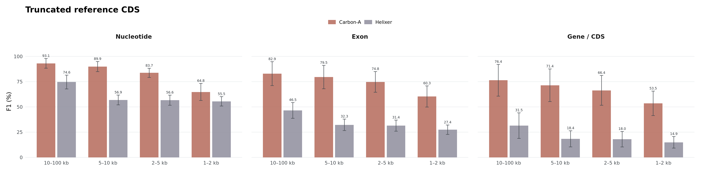
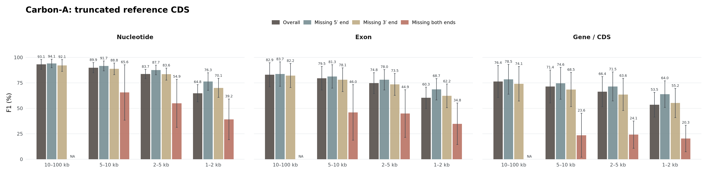
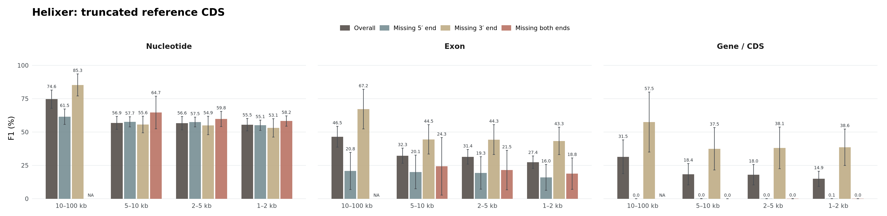

# Fungal gene calling benchmark

Compare fungal gene prediction on original assemblies and whole-genome random fragments, using reference-defined complete and truncated CDS.

## Scope and completion

**17 fungal species × 5 input conditions × 4 tools = 340 completed and independently validated cases.** ANNEVO, Tiberius, Carbon-A and Helixer each have 85 cases. Inputs are original assemblies and whole-genome random partitions of 1–2 kb, 2–5 kb, 5–10 kb and 10–100 kb.

Complete reference CDS are compared across all four tools. Carbon-A and Helixer are also compared on truncated reference CDS, including missing 5′, missing 3′ and both ends. Frozen inputs, 340 native GFFs and checksums are available in the [v1.2 data release](https://github.com/WeStrainGroup/fungal_gene_calling_benchmark/releases/tag/v1.2).

## Tested software and models

Versions are frozen across all five input conditions. This benchmark does not claim that every predictor is the latest release. Official versions were checked on 2026-11-23.

| Tool | Tested software | Model | Official version check |
| --- | --- | --- | --- |
| ANNEVO | v2.3.3, commit [`42c920f`](https://github.com/xjtu-omics/ANNEVO/commit/42c920f70f52f96c7c06c665a639ec47d9304fff) | `ANNEVO_Fungi.pt` | Matches the current official main commit. |
| Tiberius | **2.0.7** | Official fungi weights, downloaded 2026-09-27 | **Not the latest release:** [v2.0.9](https://github.com/Gaius-Augustus/Tiberius/releases/tag/v2.0.9) was published on 2026-10-05. |
| Helixer | **v0.3.8**; HelixerPost **0.4.0**; GeenuFF **0.4.0** | `fungi_v0.3_a_0100.h5` | Latest formal release at the 2026-11-23 check; published that day. All 85 cases completed. |
| Carbon-A | Carbon-A-1.2B, pipeline/evaluator revision [`ee63599`](https://huggingface.co/HuggingFaceBio/Carbon-A-1.2B/tree/ee6359990109eef6adccfd19aba8ca64b48ae514) | Published 1.2B checkpoint | Matches the revision displayed on the official repository; weights match its published SHA256. `1.2B` denotes model size, not a software version. |

The ANNEVO, Tiberius and Carbon-A weight hashes and 61 recorded source fingerprints were rechecked against the running installation. Full hashes and dependencies are in [software metadata](metadata/software.json), [source fingerprints](metadata/source_sha256.json), and [Tiberius model provenance](metadata/tiberius_model_source.json). Carbon-A's Transformers compatibility changes are author-supplied and match its [official provenance](https://huggingface.co/HuggingFaceBio/Carbon-A-1.2B/blob/main/provenance.json); they are not an additional benchmark patch. Carbon-A uses SDPA rather than the authors' FlashAttention2 configuration, so inference is not claimed bit-identical. Helixer commits, dependencies and model hashes are in [Helixer metadata](metadata/helixer.json). Tiberius remains at 2.0.7 to match the existing WGS analysis; it was not upgraded for this extension. See [run settings](docs/run_predictors.md).

## Inputs and evaluation

The [species table](metadata/species.tsv) lists the 17 accession versions and selection sources. Helixer adds its six `test (used)` fungal species from Supplementary Table S17; Neurospora crassa is already present and reused, so five genomes are new. This is not a uniformly unseen-species benchmark; see [datasets and training exposure](docs/datasets.md).

All tools receive identical nuclear DNA. Cut points are independent of gene positions. Existing accessions, annotations, genetic codes, seeds and fragment maps are frozen. Newly added species use an independent seeded random partition for each length condition. Every record is reconstructed and checksum-verified.

Only records ≥1 kb enter scoring. Shorter original records are retained and counted. The 17-species set contains 690,727,699 bp. Its 771 records below 1 kb total 560,320 bp, all from Agaricus bisporus.

### Complete and truncated reference CDS

A CDS is the spliced coding region of one transcript. Original reference CDS are qualified for complete coding structure, valid introns, start/stop codons and reading frame under each genome’s genetic code, then mapped onto the fragments.

| Class | Definition | Comparison |
| --- | --- | --- |
| Complete (C) | All original coding bases remain in the fragment. | ANNEVO, Tiberius, Carbon-A and Helixer. |
| Truncated (T) | Some original coding bases fall outside the fragment. | Carbon-A and Helixer: Overall, missing 5′ end, missing 3′ end and missing both ends. |

Completeness follows reference coordinates, not predicted status. A fragment may contain both classes, and a cut within an intron can truncate a CDS when coding exons lie outside the fragment.

The table summarizes reference gene–fragment instances across all 17 species after qualification, the ≥200 bp visible-CDS cutoff and scoring-region exclusions. Isoforms are not counted separately. One original gene may contribute truncated instances in several fragments, so C + T need not equal the original gene count.

| Input condition | Complete (C) | Truncated (T) |
| --- | ---: | ---: |
| Original assembly | 192,423 | 0 |
| 10–100 kb | 187,311 | 8,497 |
| 5–10 kb | 153,090 | 65,822 |
| 2–5 kb | 113,078 | 136,415 |
| 1–2 kb | 51,192 | 275,133 |

Per-species counts are available in the [metrics table](results/metrics.tsv), using `level=gene` and `reference`. Complete reference counts agree across all four tools; truncated counts agree between Carbon-A and Helixer (`stratum=partial`).

### Prediction filters

Released models and native postprocessing are retained. The benchmark applies a visible, spliced CDS cutoff of ≥200 bp to references and predictions, including retained terminal-stop bases and boundary residues. Carbon-A also requires confidence ≥0.1 or explicit NA; missing confidence is an error.

The confidence cutoff follows Carbon-A’s [reference-evaluation rule for genes](https://huggingface.co/HuggingFaceBio/Carbon-A-1.2B/blob/ee6359990109eef6adccfd19aba8ca64b48ae514/annotation_pipeline/README.md#reference-evaluation). Its native pipeline exports models before this filter and assigns NA to record-edge-truncated genes. We apply the same filtered prediction set at all three scoring levels; upstream applies confidence filtering only to gene/protein metrics.

HelixerPost 0.4.0 exports partial models; its inherited `partial=true` flag is retained as audit metadata. Helixer has no Carbon-A confidence score, so that tool-specific filter is not applied to Helixer. No additional filter removes predictions for incorrect codons, phase or completeness status. [Run settings](docs/run_predictors.md) document the departures from defaults: Carbon-A’s input-length filter is disabled, its native 96 bp minimum CDS precedes the common cutoff, and Tiberius uses a 1,000 bp minimum input.

### Scoring

Nucleotide and exon scoring reuse the frozen interval definitions from the [Carbon-A technical report](https://www.biorxiv.org/content/10.64898/2026.10.20.760448v1). Gene scoring requires exact coding structure and reading frame.

| Level | Requirement for a true positive |
| --- | --- |
| Nucleotide | A coding base overlaps reference coding sequence on the same record and strand. |
| Exon | A merged coding-exon interval matches both reference boundaries on the same record and strand. These are CDS intervals, not UTR-containing transcript exons. |
| Gene / CDS | The full visible CDS exon-coordinate chain and reading frame match on the same record and strand. For a truncated reference, the entire visible portion and its initial phase must match. |

Nucleotide and exon scoring use the longest eligible visible isoform per gene and merge intervals by record and strand. Gene scoring matches any eligible isoform one-to-one, with at most one TP per reference gene per fragment. Duplicate predictions cannot add TPs, and identical sequence at another locus is not a match. Explicit stop-codon features are normalized with CDS coordinates.

Scoring regions follow reference CDS spans, including internal introns, on each record and strand:

- Complete-reference regions and scoreable background form the main comparison; unmatched predictions count as FP.
- Predictions wholly within truncated-reference regions enter the Carbon-A/Helixer truncated comparison; unmatched predictions count as FP within that scope.
- Failed, too-short or ambiguously classified references and conflicting same-strand overlap regions are excluded. Predictions overlapping excluded regions or crossing truncated-scope boundaries are reported separately, without clipping. Unrecovered scoreable references still count as FN.

Truncated precision and F1 are conditional on truncated-reference regions, not whole-genome estimates. Full isoform, phase and exclusion rules are in [Methods](docs/methods.md); [diagnostics](results/diagnostics.tsv) report background FP and excluded predictions.

## Results

All 340 cases finished on 2026-11-24. Independent validation checked **1,603,921 gene true positives**, their native GFF coordinates/phase and gene-level count reconciliation; all 544 source files retained their checksums. R independently verified all **540 summary rows**. See [structural validation](results/independent_validation.json) and [summary validation](results/validation.json).

### Complete reference CDS

Across 17 species, Carbon-A has the highest mean gene/CDS F1 on original assemblies, 10–100 kb and 5–10 kb inputs. Tiberius has the highest mean F1 at all three scoring levels on 2–5 kb and 1–2 kb inputs. At 5–10 kb, Tiberius leads nucleotide F1, while Carbon-A leads exon and gene/CDS F1. These are descriptive results on these species, not a uniformly unseen-species comparison or a statistical equivalence test.

Mean gene/CDS F1 (%):

| Input | ANNEVO | Tiberius | Carbon-A | Helixer |
| --- | ---: | ---: | ---: | ---: |
| Original | 57.8 | 60.9 | 72.6 | 48.1 |
| 10–100 kb | 57.3 | 60.0 | 71.7 | 43.6 |
| 5–10 kb | 53.8 | 58.9 | 60.4 | 32.0 |
| 2–5 kb | 43.8 | 58.1 | 53.7 | 31.0 |
| 1–2 kb | 20.6 | 54.7 | 37.0 | 27.7 |


Bars show species-equal mean F1; error bars show sample SD across 17 species. Each species is scored from its combined fragment counts before averaging; counts are not pooled across species. Undefined values remain NA. See [per-species TP/FP/FN and rates](results/metrics.tsv), [mean and SD](results/mean_sd.tsv), [input counts](results/inputs.tsv) and [filtering/background diagnostics](results/diagnostics.tsv).

### Truncated reference CDS

Carbon-A has higher mean F1 than Helixer at all three levels and all four fragment conditions. Mean gene/CDS F1 (%) within truncated-reference regions:

| Input | Carbon-A | Helixer |
| --- | ---: | ---: |
| 10–100 kb | 76.4 | 31.5 |
| 5–10 kb | 71.4 | 18.4 |
| 2–5 kb | 66.4 | 18.0 |
| 1–2 kb | 53.5 | 14.9 |



Truncated precision/F1 are conditional on truncated-reference regions, not whole-genome estimates. Overall scores use the aggregate stratum within each species, not an average of truncation subtypes. Background FP and cross-scope predictions remain in the diagnostics.

The subtype plots distinguish missing 5′, missing 3′ and both ends:





Helixer's exact gene/CDS scores are strongly asymmetric: missing-5′ and missing-both scores are near zero, whereas missing-3′ scores are substantially higher. This is the output under the shared coordinate-and-phase criterion; partial-output support alone does not establish accurate recovery of every truncation type. No 10–100 kb input has an eligible missing-both reference, so those cells are NA rather than zero. See `n_species` in the summary for each cell's denominator.

## Reproduce

### Get the code and redraw figures

```bash
git clone --branch v1.2 --depth 1 https://github.com/WeStrainGroup/fungal_gene_calling_benchmark.git
cd fungal_gene_calling_benchmark
Rscript -e 'install.packages("ggplot2", repos="https://cloud.r-project.org")'
Rscript scripts/plot_all_species.R results figures
Rscript scripts/validate_summary.R results
```

### Recalculate scores from native predictions

Download `fungal_benchmark_data_v1.2.tar.gz` and `SHA256SUMS` from the [data release](https://github.com/WeStrainGroup/fungal_gene_calling_benchmark/releases/tag/v1.2). The archive contains the 17 frozen inputs/references, fragment maps, genetic codes and 340 native GFFs. Model weights, environments and intermediate probability arrays are not required. Verify and extract it in the repository root:

```bash
sha256sum -c SHA256SUMS
tar -xzf fungal_benchmark_data_v1.2.tar.gz
(cd data && sha256sum -c SHA256SUMS)
python3.12 -m venv .venv
source .venv/bin/activate
python -m pip install -r requirements.txt
python -m unittest discover -s tests -v

python scripts/evaluate_stratified.py --data data --samples data/samples.tsv \
  --cohort fungal_benchmark --output data/evaluation
python scripts/validate_stratified.py --data data --output data/evaluation
python scripts/summarize_all_species.py --inputs data/evaluation \
  --species data/samples.tsv --output data/results
Rscript scripts/plot_all_species.R data/results data/results/figures
Rscript scripts/validate_summary.R data/results
```

Scoring is CPU-only; no repeated GPU inference is needed. On macOS, `shasum -a 256 -c` can replace `sha256sum -c`. Recalculated outputs stay under `data/`; published tables remain in `results/`. [Run settings](docs/run_predictors.md) describe native inference, and the [script registry](docs/methods.md#implementation) records the maintained scripts and completed checks.

## Contact

Xinyu Wang: [wangxinyu30@westlake.edu.cn](mailto:wangxinyu30@westlake.edu.cn)

## License

Copyright © 2026 WeStrainGroup. [CC BY-NC-SA 4.0](https://creativecommons.org/licenses/by-nc-sa/4.0/) covers our benchmark scripts and documentation. The vendored Carbon-A evaluator retains its Apache 2.0 license; predictors, model weights and reference datasets retain their own terms. See [third-party notices](THIRD_PARTY.md).
