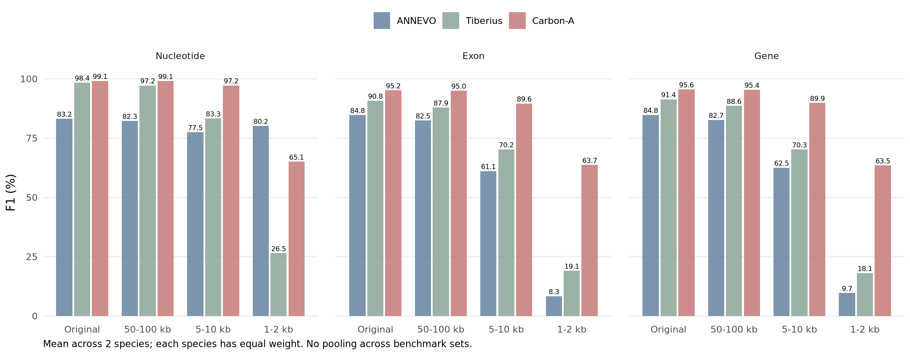

# Fungal gene calling benchmark

**How well do fungal gene callers recover CDS when assemblies are fragmented?**

A reproducible comparison of **ANNEVO**, **Tiberius** and **Carbon-A** on identical fungal DNA, with original assemblies and full-genome partitions targeting **1–2 kb**, **5–10 kb** and **50–100 kb**. No RNA or protein evidence is supplied to the predictors.

The primary question is short-contig performance. Reference CDS are clipped to each fragment, so an exact partial-CDS prediction can be a true positive; that does **not** imply recovery of a full-length protein.

## Benchmark sets

| Set | Species | Status | Training overlap |
| --- | ---: | --- | --- |
| ANNEVO fungal test species | 2 | Complete: 24 primary runs + 48 single-record runs | Both species are in Tiberius's published training list. |
| Tiberius primary fungal test species | 6 | Inputs verified; GPU runs queued/running | Tiberius's benchmark documentation states that none trained Tiberius or ANNEVO. |
| Carbon-A official fungal evaluation set | 5 | Inputs verified; 12 yeast cases reused; 48 new runs waiting | The official data description lists all five as `seen`; no unseen fungi. |

These are independently rerun comparisons on the authors' selected species, **not a reproduction of their published headline scores**. We use one common evaluator and explicit reference screening. The sets remain separate; means give each species equal weight, with **no SD or error bars**. Per-species tables are always retained. Incomplete sets are not averaged or filled with zeros.

The completed two-species results are shown below; expanded-set summaries will be released after output verification.



**In this initial set**, Carbon-A has the highest exon and gene F1 in every length condition. On 1–2 kb inputs ANNEVO has higher nucleotide F1 but substantially lower exon and gene F1. This illustrates why coding-base coverage alone is insufficient. These two yeast genomes do not establish a general ranking for fungal MAGs.

[Full results](results/benchmark.tsv) · [Mean table](results/annevo_set_mean.tsv) · [PDF figure](figures/annevo_set/benchmark_mean.pdf) · [Per-species figure](figures/benchmark_f1.pdf) · [Methods](docs/methods.md) · [Datasets and training overlap](docs/datasets.md) · [Run predictors](docs/run_predictors.md)

## Reproduce the completed results

Linux, Python 3.11 and `curl` are sufficient for CPU reevaluation. The release data archive is about **21 MB**; models and GPU inference are not needed.

```bash
git clone https://github.com/WeStrainGroup/fungal_gene_calling_benchmark.git
cd fungal_gene_calling_benchmark
python -m venv .venv
source .venv/bin/activate
pip install -r requirements.txt

python scripts/fetch_data.py
python scripts/prepare_inputs.py
python scripts/evaluate.py
python scripts/compare_inputs.py
```

The scripts check the release archive, original RefSeq files, exact tested input sequences, official evaluator output and an independent maximum-matching algorithm. Reevaluation must reproduce **all 72 published metric rows exactly**. Single-record comparisons must reproduce all four published tool/species summaries.

To redraw the existing figure with R and ggplot2:

```bash
Rscript -e 'install.packages("ggplot2", repos="https://cloud.r-project.org")'
Rscript scripts/plot.R results/annevo_set_mean.tsv figures/annevo_set
```

To compute a species-equal summary for a **single complete benchmark set**:

```bash
python scripts/summarize.py results/benchmark.tsv data/annevo_set_mean.tsv
Rscript scripts/plot.R data/annevo_set_mean.tsv data/figures
```

`data/` contains downloaded and regenerated files and is excluded from Git. Public reference DNA/GFF, frozen fragment maps, and the **72 native prediction GFFs** are in the [release archive](https://github.com/WeStrainGroup/fungal_gene_calling_benchmark/releases/tag/v0.1.0). Versioned source URLs, model hashes and parameters are in `metadata/` and the methods documentation.

## What is included

| Directory | Contents |
| --- | --- |
| `scripts/` | Download, exact input reconstruction, evaluation, input-equivalence check, inference wrapper, summaries and R figures. |
| `results/` | Per-species P/R/F1, TP/FP/FN, denominators, runtime and validation tables. |
| `figures/` | Publication-ready PDF and matching PNG preview. |
| `docs/` | Evaluation definitions, dataset provenance, reproduction commands and script registry. |
| `metadata/` | Input/model/evaluator checksums, fixed random seeds and source references. |
| `vendor/carbon_a/` | Three unmodified official evaluator files, pinned by revision and SHA256. |

See [script status](docs/scripts.md). Site-specific paths, SSH settings, scheduler logs, model weights and temporary inference files are not included.

## Scope

One fixed partition per size range; no simulated base errors, contamination or real MAG missingness. Reference annotations are not experimental truth for every gene. Native predictor filters differ and remain active. Carbon-A training exposure is not fully audited for every set. These limitations apply when interpreting absolute accuracy or extending the findings to other fungi.

## Sources and licensing

- [ANNEVO](https://github.com/xjtu-omics/ANNEVO), [Tiberius](https://github.com/Gaius-Augustus/Tiberius), [Carbon-A](https://huggingface.co/HuggingFaceBio/Carbon-A-1.2B).
- [RefSeq](https://www.ncbi.nlm.nih.gov/refseq/) reference assemblies and annotations; exact accession versions are recorded.
- Original benchmark code: [MIT](LICENSE). Vendored Carbon-A evaluator: [Apache 2.0](vendor/carbon_a/LICENSE). See [third-party notices](THIRD_PARTY.md) before using external predictor software or data.

Please cite the predictor publications and the reference assemblies as well as this repository/release. `CITATION.cff` provides repository citation metadata.
