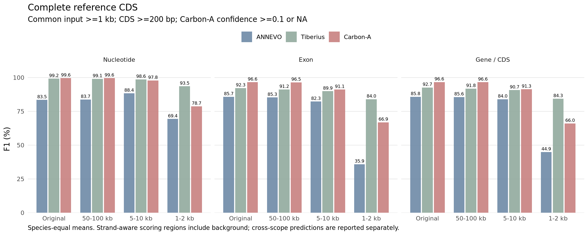

# Fungal gene calling benchmark

**How well do fungal gene callers recover CDS when assemblies are fragmented?**

A reproducible comparison of **ANNEVO**, **Tiberius** and **Carbon-A** on identical fungal DNA, with original assemblies and full-genome partitions targeting **1–2 kb**, **5–10 kb** and **50–100 kb**. No RNA or protein evidence is supplied to the predictors.

**Current protocol: v0.2 — reference-defined complete and truncated CDS, matched by coordinates and reading frame.** Three tools are compared on complete reference CDS; Carbon-A is additionally evaluated on truncated reference CDS. Mixed fragments are retained. All metrics use the same filtered predictions (visible CDS >=200 bp; Carbon-A confidence >=0.1 or explicit NA) on input records >=1 kb.

The historical v0.1 results used native settings, allowed partial CDS and matched gene/CDS sequences. They remain available unchanged, but **must not be combined with v0.2 scores**.

## Benchmark sets

| Set | Species | Status | Training overlap |
| --- | ---: | --- | --- |
| ANNEVO fungal test species | 2 | v0.2 complete: 24/24 cases; historical 48 single-record runs retained | Both species are in Tiberius's published training list. |
| Tiberius primary fungal test species | 6 | v0.2 snapshot: 57/72 cases independently validated; remainder running/queued | Tiberius's benchmark documentation states that none trained Tiberius or ANNEVO. |
| Carbon-A official fungal evaluation set | 5 | v0.2 snapshot: 12/60 cases independently validated; 48 new runs waiting | The official data description lists all five as `seen`; no unseen fungi. |

These are independently rerun comparisons on the authors' selected species, **not a reproduction of their published headline scores**. We use one common evaluator and explicit reference screening. The sets remain separate; means give each species equal weight, with **no SD or error bars**. Per-species tables are always retained. Incomplete sets are not averaged or filled with zeros.

Snapshot: 2026-11-18 09:56 UTC. [Validation/status](metadata/v0.2/validation.json) · [Tiberius-set partial results](results/v0.2/tiberius_set) · [Carbon-A-set partial results](results/v0.2/carbon_set). The reused yeast metrics were checked for exact equality across cohorts. Partial extension tables are interim outputs; their native predictions will be packaged after the respective cohort finishes.

## Current results and validation

The ANNEVO-selected two-species pilot is complete under v0.2: **24/24 cases**, 24 boundary tests passed, and **106,556 gene matches** were independently checked against raw GFF coordinates and phase. All 44 source hashes remained unchanged. The Tiberius-selected and Carbon-A-selected sets remain incomplete; their species means are withheld.



For complete CDS on 1–2 kb inputs, species-equal gene F1 is **84.33% for Tiberius, 66.05% for Carbon-A and 44.89% for ANNEVO**. These two yeast genomes do not establish a general fungal ranking. Carbon-A's truncated-CDS gene F1 is **68.35%**, conditional on truncated-reference regions; it is not whole-genome precision/F1.

[Metrics and counts](results/v0.2/annevo_set/metrics.tsv) · [Species means](results/v0.2/annevo_set/species_mean.tsv) · [Background and exclusions](results/v0.2/annevo_set/diagnostics.tsv) · [Truncated CDS figure](figures/v0.2/annevo_set/carbon_partial_cds.pdf) · [Independent validation](results/v0.2/annevo_set/independent_validation.json)

[Current methods](docs/methods_v0.2.md) · [Datasets and training overlap](docs/datasets.md) · [Run predictors](docs/run_predictors.md) · [Script registry](docs/scripts.md)

## Reproduce v0.2 without GPU inference

The unchanged v0.1 input archive contains the original DNA, annotations, fragment maps and native predictions needed for the v0.2 pilot. The new evaluator reads confidence from native GFFs.

```bash
git clone https://github.com/WeStrainGroup/fungal_gene_calling_benchmark.git
cd fungal_gene_calling_benchmark
python -m venv .venv
source .venv/bin/activate
pip install -r requirements.txt
python scripts/fetch_data.py
python scripts/prepare_inputs.py
python -m unittest discover -s tests -v
python scripts/evaluate_stratified.py --data data --output data/evaluation_v0.2 --cohort annevo_set
python scripts/validate_stratified.py --data data --output data/evaluation_v0.2
Rscript -e 'install.packages(c("ggplot2", "jsonlite"), repos="https://cloud.r-project.org")'
Rscript scripts/plot_stratified.R data/evaluation_v0.2 data/evaluation_v0.2/figures
```

For extensions, supply `--samples metadata/tiberius_samples.tsv` or `metadata/carbon_samples.tsv` and the corresponding frozen input root. `--completed-only` requires native `COMPLETE` markers. `finish_stratified.py` provides a separate, locked CPU follow-up: it evaluates the available cases once, waits for the remaining native outputs, then validates and plots a complete cohort. It never runs inference, publishes to GitHub or changes native outputs.

`data/` is excluded from Git. Large per-model audits are distributed in the [v0.2 release](https://github.com/WeStrainGroup/fungal_gene_calling_benchmark/releases/tag/v0.2.0), with [SHA256 metadata](metadata/v0.2/audit_asset.json); compact verified tables and figures are tracked here. Source URLs, model hashes and inference parameters remain in `metadata/`.

## Historical v0.1

[Original metrics](results/benchmark.tsv) · [Original means](results/annevo_set_mean.tsv) · [Original figure](figures/annevo_set/benchmark_mean.pdf) · [Original methods](docs/methods.md) · [Frozen release](https://github.com/WeStrainGroup/fungal_gene_calling_benchmark/releases/tag/v0.1.0)

To reproduce only that historical protocol, run `python scripts/evaluate.py` and `python scripts/compare_inputs.py` after fetching and preparing the same archive. The original 72 metric rows and four input-equivalence summaries are retained. v0.2 changes the scientific endpoint and can change the ranking; its scores are not a corrected version of the same endpoint.

## What is included

| Directory | Contents |
| --- | --- |
| `scripts/` | Download, exact input reconstruction, evaluation, input-equivalence check, inference wrapper, summaries and R figures. |
| `results/` | Per-species P/R/F1, TP/FP/FN, denominators, runtime and validation tables. |
| `figures/` | Publication-ready PDF and matching PNG preview. |
| `docs/` | Evaluation definitions, dataset provenance, reproduction commands and script registry. |
| `metadata/` | Input/model/evaluator checksums, fixed random seeds and source references. |
| `vendor/carbon_a/` | Three unmodified official evaluator files, pinned by revision and SHA256. |

See [script status](docs/scripts.md). Site-specific paths, SSH settings, scheduler logs, model weights and temporary inference files are not included.

## Scope

One fixed partition per size range; no simulated base errors, contamination or real MAG missingness. Reference annotations are not experimental truth for every gene. Native predictor filters differ and remain active. Carbon-A training exposure is not fully audited for every set. These limitations apply when interpreting absolute accuracy or extending the findings to other fungi.

## Sources and licensing

- [ANNEVO](https://github.com/xjtu-omics/ANNEVO), [Tiberius](https://github.com/Gaius-Augustus/Tiberius), [Carbon-A](https://huggingface.co/HuggingFaceBio/Carbon-A-1.2B).
- [RefSeq](https://www.ncbi.nlm.nih.gov/refseq/) reference assemblies and annotations; exact accession versions are recorded.
- Original benchmark code: [MIT](LICENSE). Vendored Carbon-A evaluator: [Apache 2.0](vendor/carbon_a/LICENSE). See [third-party notices](THIRD_PARTY.md) before using external predictor software or data.

Please cite the predictor publications and the reference assemblies as well as this repository/release. `CITATION.cff` provides repository citation metadata.
