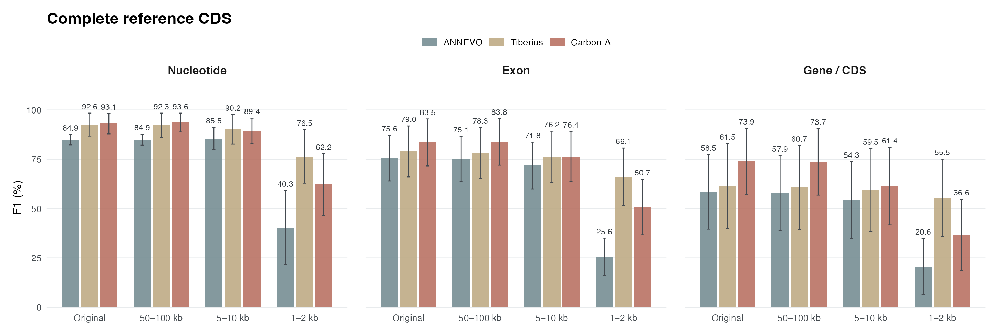

# Fungal gene calling benchmark

This benchmark compares ANNEVO, Tiberius and Carbon-A on 12 fungal species drawn from the three tools’ test datasets. For each tool and fragmentation condition, we report the mean ± SD of each metric across species, with equal weight per species.

Conditions comprise the original assembly, 1–2 kb, 5–10 kb and 50–100 kb full-genome random partitions. All tools receive identical DNA; no RNA or protein evidence is supplied. Saccharomyces cerevisiae is counted once.

| Species | Assembly | Source |
| --- | --- | --- |
| *Saccharomyces cerevisiae* | GCF_000146045.2 | ANNEVO, Carbon-A |
| *Candida albicans* | GCF_000182965.3 | ANNEVO |
| *Agaricus bisporus* | GCF_000300555.1 | Tiberius |
| *Cryphonectria parasitica* | GCF_011745365.1 | Tiberius |
| *Parastagonospora nodorum* | GCF_000146915.1 | Tiberius |
| *Puccinia striiformis* | GCF_021901695.1 | Tiberius |
| *Punctularia strigosozonata* | GCF_000264995.1 | Tiberius |
| *Tilletiopsis washingtonensis* | GCF_003144115.1 | Tiberius |
| *Schizosaccharomyces pombe* | GCF_000002945.2 | Carbon-A |
| *Neurospora crassa* | GCF_000182925.2 | Carbon-A |
| *Coprinopsis cinerea* | GCF_000182895.1 | Carbon-A |
| *Rhizophagus irregularis* | GCF_026210795.1 | Carbon-A |

## Evaluation

The v0.2 scoring protocol is unchanged: compare all three tools on complete reference CDS, and assess Carbon-A separately on truncated reference CDS. Gene/CDS matches require identical visible CDS coordinates, strand and reading frame. Main scoring uses input records >=1 kb and visible CDS >=200 bp; Carbon-A retains confidence >=0.1 or explicit NA.

Metrics are first computed per species. The final summary combines all 12 species using the arithmetic mean and sample SD (n−1) of defined values. Missing values are never replaced with zero; each row reports `n_species`. SD is NA for fewer than two defined species. Original assemblies are a separate condition.

## Results

Completed 2026-11-21: 144/144 prediction cases, comprising the same 12 species in all four conditions (48 species × condition pairs). All source evaluations and independent coordinate/phase and count checks passed. R independently verified all 252 summary rows.

Complete-reference gene/CDS F1 (%), species-equal mean ± sample SD:

| Condition | Species | ANNEVO | Tiberius | Carbon-A |
| --- | ---: | ---: | ---: | ---: |
| Original assembly | 12 | 58.49 ± 18.97 | 61.47 ± 21.50 | 73.95 ± 16.70 |
| 50–100 kb | 12 | 57.87 ± 19.02 | 60.73 ± 21.29 | 73.67 ± 16.88 |
| 5–10 kb | 12 | 54.27 ± 19.46 | 59.46 ± 20.99 | 61.37 ± 19.66 |
| 1–2 kb | 12 | 20.62 ± 14.25 | 55.50 ± 19.57 | 36.59 ± 18.08 |



Carbon-A has the highest mean complete-CDS gene F1 for original assemblies and 50–100 kb inputs. Tiberius retains the highest mean at 1–2 kb. These are descriptive comparisons across the selected species, not an unseen-species generalization claim. Carbon-A's truncated-CDS scores are conditional on truncated-reference regions; they are not whole-genome precision estimates.

[All metrics: mean ± SD](results/mean_sd.tsv) · [Per-species TP/FP/FN and P/R/F1](results/metrics.tsv) · [Background and exclusions](results/diagnostics.tsv) · [Truncated CDS figure](figures/carbon_partial_cds.pdf) · [Validation](results/validation.json)

[Methods](docs/methods.md) · [Datasets](docs/datasets.md) · [Script registry](docs/methods.md#implementation)

## Reproduce

Run the commands from the repository root. Choose either figure-only rendering or CPU rescoring below. The released inputs and native predictions are sufficient; neither route requires model installation or GPU inference.

### Set up

```bash
git clone https://github.com/WeStrainGroup/fungal_gene_calling_benchmark.git
cd fungal_gene_calling_benchmark
Rscript -e 'install.packages(c("ggplot2", "jsonlite"), repos="https://cloud.r-project.org")'
```

For CPU rescoring, also create a Python 3.12 environment:

```bash
python3.12 -m venv .venv
source .venv/bin/activate
python -m pip install -r requirements.txt
```

### Redraw figures from the published summary

```bash
Rscript scripts/plot_all_species.R results figures
```

This reads `results/mean_sd.tsv` and writes PNG/PDF files to `figures/`. It does not download the data or recalculate scores.

### Recalculate scores from native predictions

The [v1.0.0 data release](https://github.com/WeStrainGroup/fungal_gene_calling_benchmark/releases/tag/v1.0.0) contains all 12 frozen RefSeq inputs, fragment maps, genetic codes and 144 native prediction GFFs. The archive is approximately 1.03 GB; extraction and evaluation require additional disk space. `fetch_data.py` checks the archive SHA256 and every extracted file.

Download and verify the data, then run the scoring tests:

```bash
python scripts/fetch_data.py
python -m unittest discover -s tests -v
```

Evaluate and independently validate each source dataset:

```bash
for cohort in pilot tiberius carbon; do
  python scripts/evaluate_stratified.py --data data \
    --samples metadata/${cohort}_samples.tsv --cohort ${cohort}_set \
    --output data/${cohort}_results
  python scripts/validate_stratified.py --data data --output data/${cohort}_results
done
```

Combine the validated results, count the shared species once, and draw the figures:

```bash
python scripts/summarize_all_species.py \
  --inputs data/pilot_results data/tiberius_results data/carbon_results \
  --output combined_results
Rscript scripts/plot_all_species.R combined_results combined_results/figures
```

Outputs are `combined_results/metrics.tsv` (per-species TP/FP/FN and rates), `mean_sd.tsv` (species-equal mean and sample SD), `diagnostics.tsv` (filtering and excluded predictions), validation reports, and `figures/`. Published reference tables remain in `results/`.

### Run predictors on new inputs

See [Running the predictors](docs/run_predictors.md) for environments, model versions and inference commands. This is optional and separate from reproducing the released scores. The [script registry](docs/methods.md#implementation) describes the maintained code; [validation evidence](results/validation.json) records the completed checks.

## Sources and license

[ANNEVO](https://github.com/xjtu-omics/ANNEVO) · [Tiberius](https://github.com/Gaius-Augustus/Tiberius) · [Carbon-A](https://huggingface.co/HuggingFaceBio/Carbon-A-1.2B) · [RefSeq](https://www.ncbi.nlm.nih.gov/refseq/)

Benchmark code: [MIT](LICENSE). Vendored evaluator: [Apache 2.0](vendor/carbon_a/LICENSE). See [third-party notices](THIRD_PARTY.md), versioned metadata and `CITATION.cff`.
